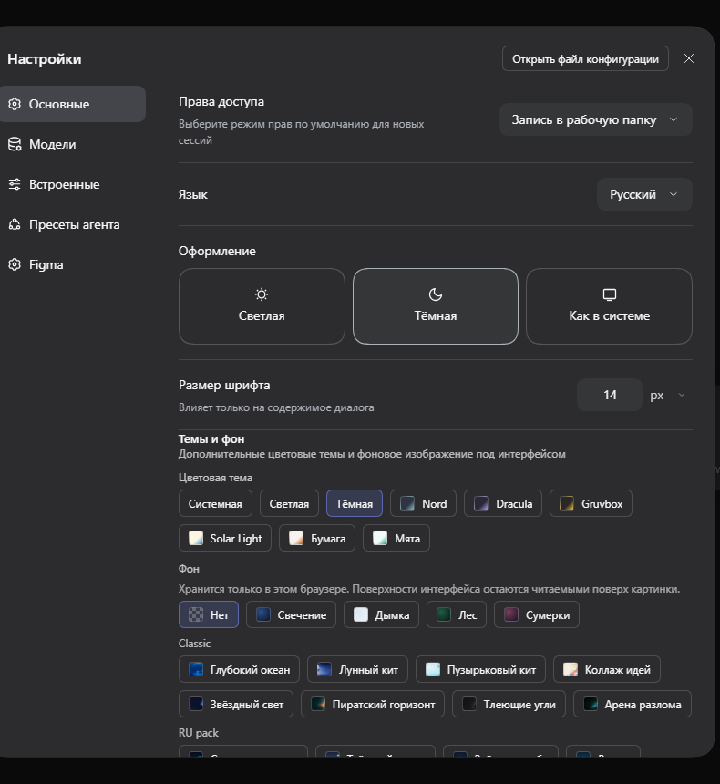
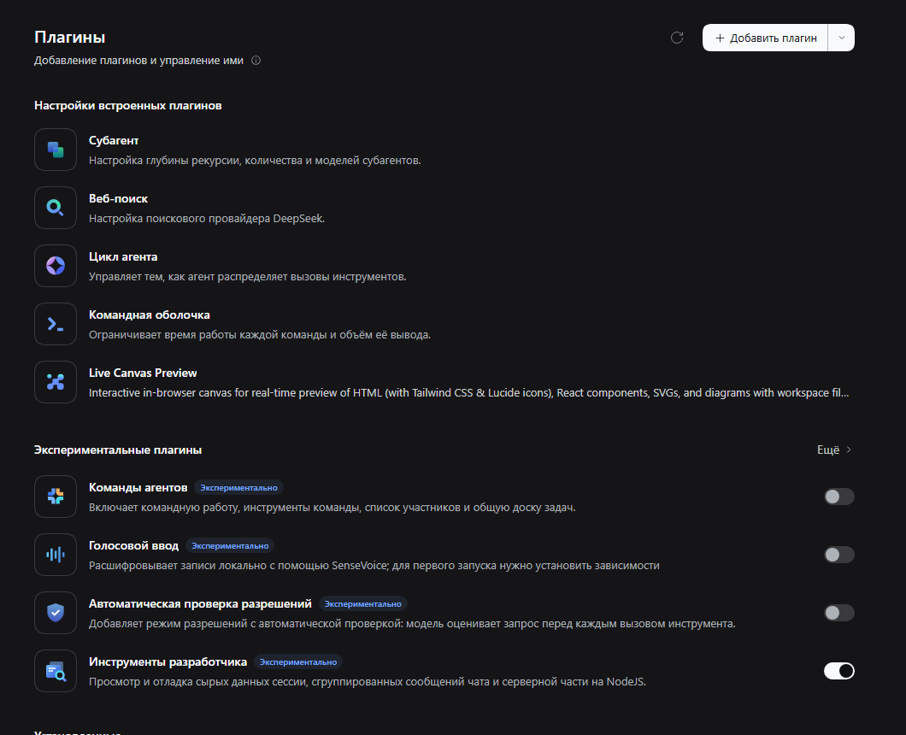

<!-- deepseek-harness-meta
{
  "name": "Russian (ru) language pack for DeepSeek Harness",
  "version": "0.2.1",
  "tags": ["localization", "russian", "i18n", "web-gui", "language-pack"],
  "description": "Full Russian interface for the DeepSeek Harness web GUI: 77 namespaces, 4495 translated strings, Russian screen typography, and a locale audit in CI pinned to a harness tag. Includes the automation-task manager and the reminder catalog.",
  "icon": "https://raw.githubusercontent.com/Ragnoryok1/dsh-client-locale-ru/main/assets/icon.png",
  "compatible_versions": ["v0.2.1-rc.2", "v0.2.1-rc.1", "v0.2.1-alpha.5", "v0.2.1-alpha.4", "v0.2.1-alpha.3", "v0.2.1-alpha.2", "v0.2.1-alpha.1", "v0.2.0-rc.2", "v0.2.0-rc.1", "v0.1.7-rc.2", "v0.1.7-rc.1", "v0.1.7-alpha.2"],
  "screenshots": "images",
  "install_method": "dsh plugin --profile web add @ragnoryok1/dsh-client-locale-ru"
}
-->

# @ragnoryok1/dsh-client-locale-ru

[Русский](README.md) | **English** | [中文](README.zh.md)


[](https://www.npmjs.com/package/@ragnoryok1/dsh-client-locale-ru)
[](LICENSE)
[](https://github.com/Ragnoryok1/dsh-client-locale-ru/actions/workflows/verify.yml)
[](https://github.com/deepseek-ai/deepseek-harness)
[](https://github.com/Ragnoryok1/dsh-client-locale-ru)
[](https://github.com/Ragnoryok1/dsh-client-locale-ru)

Russian (`ru`) language pack for the [DeepSeek Harness](https://github.com/deepseek-ai/deepseek-harness) web GUI (`dsh`). It registers `ru` as a selectable client language through the locale service (`ctx.locale.addLanguage`) plus one dictionary per namespace — 77 namespaces, 4,495 strings, built against dsh `0.2.1-rc.2`. Install with `dsh plugin --profile web add @ragnoryok1/dsh-client-locale-ru`, then pick **Русский** in Settings → General. Missing keys fall back to English, so a newer harness keeps working. The scope is the harness's own client interface only — third-party plugin dictionaries are deliberately out of scope, and 11 of the 17 most-downloaded ecosystem plugins ship no strings of their own, so they are already Russian through these namespaces. MIT, community-maintained, not affiliated with DeepSeek.

> **If the pack was useful to you, please star the repository.** It is the only signal that a
> translation is wanted, and it is what decides which parts get worked on next.

---

The complete inventory is in [NAMESPACES.md](NAMESPACES.md): 77 namespaces, 4495 strings, with the bundled plugin dictionaries marked.

Plugins outside the harness tree are translated the same way, but their English comes from
their own publication: `plugins/<namespace>.json` records the package, version, licence and the
English strings extracted from its bundle (`npm run fetch:plugins`). That is how dictionaries
that would otherwise not exist at all get covered — today `update` (43 strings) for
`@linxin666/dsh-update`, `git-graph` (63 strings) for `@linxin666/dsh-client-ui-git-graph`,
`dsh-web-ui-usage` (63 strings) for `@linxin666/dsh-usage` and `dsh-web-ui-session-archive`
(124 strings) for `@linxin666/dsh-session-archive`, `pet` (81 strings) for `@linxin666/dsh-pet`
`remote` (115 strings) for `@linxin666/dsh-remote-web-ui`, `dsh-skill-explorer`
(75 strings) for `@linxin666/dsh-client-ui-skill-explorer` and `dsh-web-ui-market`
(106 strings) for `@linxin666/dsh-client-ui-market`, `liangshen` (42 strings) for
`@linxin666/dsh-liangshen` and `dsh-web-ui-preset-center` (46 strings) for
`@linxin666/dsh-client-ui-preset-center`, `dsh-ssh` (154 strings) for `@linxin666/dsh-ssh` and
`task-board` (437 strings) for `@linxin666/dsh-client-ui-task-board` and `task-board-github`
(113 strings) for `@linxin666/dsh-client-ui-task-board-github` — all thirteen extractable
dictionaries of that family, each translated in full. Another pack's Russian is never copied: there would be nothing to verify it
against, while the audit compares our value with the English template of that same plugin.

## What it looks like

Russian in the language list and the translated settings sections (the screenshots were taken in build `0.1.8`:
the same screen, but the wording and some sections have changed since — the font-size caption, for one, now reads
«Влияет только на содержимое диалога»):):





Both screenshots are cropped at the left edge of the panel: workspace and session names are
not in frame.

Russian locale (`ru`) for the [DeepSeek Harness](https://github.com/deepseek-ai/deepseek-harness) web GUI (`dsh`).

The plugin adds **Russian** as a selectable language through the locale's language-pack contract: `ctx.locale.addLanguage({ id: 'ru', label: 'Русский', fallback: 'en' })` plus one `ru` dictionary per namespace. Once **Русский** is picked in Settings → General, the interface switches over immediately.

> **If the package was useful to you, give it a star.** It is the only way to show that a
> translation is wanted, and it genuinely affects which tasks get taken on. Not a single
> “like” button in the interface does that.
>
> The repository, meanwhile, remains the place where the state of the translation is visible:
> a [CHANGELOG](CHANGELOG.md) breaking down every release (including the mistakes that were found
> in it by its own maintainers), the CI checks, and the list of what is deliberately not translated.

## Installation

This is a **hybrid plugin** (`dsh.bundle` + `dsh.client`), so it installs as an ordinary profile bundle through `dsh plugin`:

```sh
dsh plugin --profile web add @ragnoryok1/dsh-client-locale-ru
```

After that, the next time `dsh web` starts, **Русский** will appear in the settings. A separate `pnpm add` into a built `dsh web` is not needed — the plugin pulls in the built-in locale through the `locale` service.

The manifest is checked against the harness's own rules rather than by eye (`npm run check:manifest`, part of `verify`). Each rule was read out of the harness sources and each is a failure the user would otherwise meet first: `parseDshClient` accepts `platform` as any string while the consumers keep only `platform === 'web'`, so a typo like `'Web'` would **silently drop** the client half; a declared `dsh.client` without the `./client` export makes `client-modules` throw; and `dsh.bundle.patch` has to point at a file that exists.

Installing from GitHub works too: `dsh plugin --profile web add Ragnoryok1/dsh-client-locale-ru` (the form the plugin catalogue generates, without the npm scope) installs the repository archive, and the built `lib/` is committed — no build runs on your machine, and none is needed. That is exactly why `npm run check:built` (part of `verify`) rebuilds `lib/` and compares it with the commit: a stale bundle in git would reach the user, while the audit would never see it, because the audit reads the sources. The published package is 455 kB: the banner ships as JPEG, and the icon and source map stay out of the npm payload.

## Why hybrid

`dsh web` takes client (UI) plugins only from **workspace packages**, and an external npm package carrying just a `dsh.client` is not picked up. For an external plugin with a UI half to be installable, it has to declare **`dsh.bundle`** (the profile layer), whose `cordis.patch.yml` adds the client entry `locale-ru` to the browser roster through `- insert:`. Other third-party plugins are built the same way (for example `@zseven-w/dsh-android`).

## How it works

- **Host half** (`lib/index.js`) — an empty `apply()`: a language plugin needs no server logic, it only provides a valid cordis entry for the Loader.
- **Browser half** (`lib/client.js`) — registers `ru` and the dictionaries through the `locale` service (injected from `ctx`). There are no framework runtime imports — only the service.
- **No runtime dependencies** — `lib/client.js` imports no other packages, so it does not drag in heavy dependencies.
- **Effects** — the language and the dictionaries are registered through `ctx.effect(...)`, so they are unloaded together with the plugin (HMR-safe).
- **Plural forms** — the locale contract carries no pluralization rules: components choose the
  form as `count === 1 ? 'key.one' : 'key.other'`, while Russian needs three (1 вызов /
  2 вызова / 5 вызовов). The package takes that over: alongside `.one` and `.other` the
  dictionaries carry `.few` and `.many`, and a wrapper around the runtime's `translate`
  recomputes the form with `Intl.PluralRules('ru')` for any call carrying a numeric `count`
  or `n`. The number decides, not the key the component picked, so «2 вызова инструментов»
  and «5 вызовов инструментов» come out of the same call site. The forms are not limited to
  paired keys: where the harness passes a number to a key it never paired (`terminal.expand`
  with `{n}`), the pack adds its own `.one` / `.few` / `.many` — «Показать ещё 1 строку /
  3 строки / 7 строк» — and the wrapper looks a form up for those keys too. Where a form does
  not fit (a sentence carrying several numbers), the value is rewritten to be count-neutral:
  «Символов: {total}» instead of «{total} символов», «файлов: {files}» instead of
  «{files} файлов». Checked by `npm run check:plural` at counts 0, 1, 2, 3, 5 and 22, on an
  unpaired key, on a fractional count, and on a foreign language pack whose forms our rules
  must not rewrite.
- **Fallback** — a missing Russian key falls back to `en` (the configured `fallback`).

## Typography

The package brings already-rendered Russian text into line with typographic rules: guillemets
(«ёлочки») instead of straight quotes, an em dash instead of a hyphen between words, an ellipsis
instead of three dots, a non-breaking space between a number and the following word or unit of
measurement (so that «187 плагинов» does not break across two lines), and the same space after a
short word — a preposition, a conjunction or a particle — so that «в режим» wraps as a whole
instead of leaving «в» alone at the end of a line. The rules are deliberately conservative: they
fire only on unambiguous patterns, and code, input fields, editable text and elements with
`data-typography="off"` are not touched at all. A second pass changes nothing.

A rule for numeric ranges (an en dash in «5–10») is **deliberately absent**: the only string in
the whole pack with a hyphen between digits is the cron example `0 9 * * 1-5`, and a dash would
corrupt it. Measured, not assumed.

The rules are checked by a script rather than by eye: `npm run check:typography`.

The pass itself sees text nodes only, while a dictionary value also travels into attributes —
`title`, `aria-label`, `placeholder` — that it never reaches. The values are therefore checked
separately: the pack may not contain a straight quote, a hyphen standing for a dash, a dash
without spaces, or three dots. Otherwise the same string would look different depending on
where it landed, and in a hint or a screen-reader label the rules would not work at all.

Text that changes **after** the first pass — token counters, timers, progress — is rewritten
again, so a live «4 с» keeps its non-breaking space. This is checked on a real document rather
than on strings: `npm run check:typography:dom` (jsdom, six cases — the first pass, a later text
change, an added subtree, disposal, a foreign language, and a language switch).

The pass runs **only while Russian is active**: the rules are Russian, and applying them to
another language would edit text this pack does not own — `"quotes"` would become «quotes» in an
English interface. The pack listens to `locale/change` and starts or stops the pass on a switch
rather than on installation.

## Checks

```sh
npm run build               # the three outputs
npm run check:typography    # 18 typography rules, including "leave alone"
npm run check:locale        # dictionaries side by side: 6 checks
npm run check:plural        # plural forms: 1 вызов / 2 вызова / 5 вызовов
npm run check:composition   # composed phrases: «Пн, Ср в 09:00», «Раз в 2 дня»
npm run check:namespaces    # NAMESPACES.md matches the built bundle
npm run check:tarball       # what gets installed: the archive is unpacked and checked
npm run check:workflows     # both workflows run the whole verify chain
npm run check:readmes:pairs # the three READMEs move together (recorded section hashes)
npm run audit -- <harness tree>     # the locale audit
npm run verify -- <harness tree>    # everything together

npm run namespaces          # regenerate NAMESPACES.md and pack-count.json
npm run readmes:record      # re-record section hashes after editing all three READMEs
npm run diff:harness -- <old> <new>  # what the harness reworded under us
```

A separate check composes phrases the way the harness does and reads the result whole. The
audit compares a value with its own template, so a phrase that is correct in isolation but
broken by substitution stays invisible to it: `frequency.weekly` was filled as «По {weekdays}
в {time} », while the days arrive as «Пн, Ср» — producing «По Пн, Ср в 09:00», which no
line-by-line check can see. The same way «Каждые 2 дня» (now «Раз в 2 дня»), «Каждый день в
09:00 (Europe/Moscow)» and a composed interval with the plural forms are pinned. The third find
of the same kind: `time.locale` is not text but a tag for `Intl`, and it was `en` — a rule
restricted to a month read «Каждый день в January», and the zone label «Moscow Standard Time»
inside a Russian interface. The tag is `ru` now (the harness's Chinese dictionary uses `zh-CN`
the same way), and the month sits in parentheses: «Каждый день (январь, март)».

The same part-by-part reading found the cron wording: abbreviations («Каждые {step} мин»,
«Каждые {count} ч») and bookish turns («в минуту {minutes}», «минуты {minutes} в часы
{hours}»). The counted parts gained plural forms — «Каждые 3 минуты» / «Каждые 5 минут»,
«Каждые 2 часа» / «Каждые 6 часов» — and the rest were rewritten into one readable labelled
style: «Каждый час, минуты: 5, 30», «минуты: 5, часы: 09–17». The whole schedule sentence is
asserted end to end: «Пн–Пт каждые 5 минут». The date stamps are pinned the same way: «5 окт. 2026 г., 15:51» and the zone label «Москва, стандартное время» come from Intl with our tag, without a single Latin word.

The audit runs in CI (`.github/workflows/verify.yml`) against a **pinned harness tag**,
not against some random local checkout. The same run also fires **weekly on a schedule**: a
translation rots without anyone editing it — the upstream moves on, everything is green
locally, and the drift surfaces only when a user builds. The gates cover completeness (keys and
namespaces), plural forms, placeholders, English and Chinese residue, terminology, Latin words in
prose, text hygiene, edge spaces, style, typography of values, «ё», composed phrases, the length
of settings sidebar labels and the advertised numbers — and every one of them has already caught
real defects. Beside them the audit
prints **advisory reports**,
which are not gates because they need a human decision: how many namespaces were compared and
which could not be linked, whether any «number + inflecting word» is left, and whether a short
string grew past 2.8× its English (a layout risk — «Effort» → «Уровень рассуждения» is normal
Russian length, not a defect).

The audit reads harness templates in the shape the harness writes them: a literal, an **array of
paragraphs** (that is how the preset guides are stored) and a **reference to a constant**
(`'hint.plan': PLAN_NEXT_ACTION_EN`). While only the first shape was read, ten keys — eight of
them whole guide documents — silently fell out of every comparison. And the other way round: an
empty policy file (`keep-english.json`, a `terminology.json` section) now fails the audit instead
of widening a gate unnoticed. The numbers the READMEs advertise are checked against the pack the
same way, because a stale count is simply a wrong claim — and the same numbers are read from the
`package.json` description, which is what npm shows in search and on the package page (that is
where «55 namespaces» lived longest) — including the grouped spelling: the
old leads said `2 489`, and the gate only read the ungrouped form, so the pattern now accepts
thousands separators. The sentence naming the harness version the pack was built against is
checked next to it, against the tag the workflow pins, because that workflow is what verifies
the pack (both leads claimed `0.2.1-alpha.2` while CI had already moved to
`dsh-v0.2.1-rc.2`). The published size is measured there too: `npm run check:size` packs the
archive and compares the advertised kilobytes with the real ones, allowing one kilobyte of slack
because gzip compresses slightly differently across Node builds while the sentence rounds to
whole kilobytes.

- **dead namespaces** — every namespace the package registers has to
  exist in the harness. In 0.1.6 the schedule catalog translations were registered
  under the name `schedule.manager`, whereas `schedule.catalog` is what reads them: the per-key
  coverage check nonetheless reported «всё переведено»;
- **plural-form pairs** — the `.one`/`.other` sets have to match, because the client
  chooses the form as `count === 1 ? '.one' : '.other'`. That is not enough for Russian:
  every pair also needs `.few` and `.many`, or the wrapper quietly falls back to the neutral
  `.other` and shows «2 д» where «2 дня» was possible. The check runs **per namespace** —
  the wrapper looks the form up in the namespace that asked, so a pair missing on one screen
  while present on another would otherwise stay invisible. It found the four time units
  (`unit.day/hour/minute/second` in `schedule.catalog`) and `trigger` in the task manager;
  the units stopped being abbreviations («д», «ч», «мин») and gained full forms in the right
  case — «через 2 дня», «через 5 часов», and «Каждые 2 дня» became «Раз в 2 дня». The same
  requirement covers the keys the pack added itself (`terminal.expand` and its kin: the
  harness passes them a count but never pairs them) — their forms rest on us alone, and
  losing one would be invisible to everything else;
- **placeholders** — a Russian value has to carry exactly the `{name}` placeholders its
  English template carries: an extra one reaches the screen literally
  (`Заняло {duration}7мин 26с`, fixed in #2), a dropped one silently removes the
  interpolated value. Packages that ship only the Chinese dictionary are compared
  against `zh`. Our **own plural forms** — the `.few`/`.many` we add, and the `.one` of a key
  the harness never paired — do not exist upstream, so each is compared with the template of
  a sibling form of the same word (`.one`/`.other`) or of the key itself. Without that, 52
  values were never checked at all: that is exactly how a `{count}` can disappear from a form
  and leave the sentence without its number.
- **residue** — a value has to be Russian: an exact copy of the English template, a leftover
  Chinese character, or an empty string where the template has text is a defect. English
  copies are allowed only by a decision recorded in `scripts/keep-english.json` (addresses,
  format-only strings, protocol and tool names, abbreviations), so a new untranslated line
  cannot slip through unnoticed. The decisions themselves are checked too: an entry that no
  longer excuses anything fails the build — either its key left the pack, or the value was
  translated and the decision went stale. This is how the `deepSeekBaseUrl` entry was found:
  the English template gained a note about `DEEPSEEK_BASE_URL`, while the input placeholder
  has to be a bare example URL, so that note would have been noise inside the field. The entry
  is gone, the value stays. A decision may also name a closed list: `chat · app.*` allows
  thirty application names in one line, because a dictionary of application names is a list of
  names. And a value with no word outside its placeholders (`{from}–{to}`, `{percent}%`, `, `)
  needs no decision at all: there is nothing in it to translate, so the policy stays about
  words rather than about punctuation. The residue rule reads **every** template of a key, not
  only the `en` block: 60 values in dictionaries with an unrecognised block used to go
  unexamined, while now 2911 values are compared, 68 of them covered by decisions (38 entries,
  one of them a pattern), and the zone is gone as a class. The rule did not become wider:
  an empty value is a defect only where no template is empty either, since Russian justly
  drops the prefix that English drops too (`message.stepProcess.sharedPrefix`).
- **dead keys** — a key no harness dictionary defines and no harness source names is a
  leftover from an older version: it shows nothing and only misleads. Such keys fail the
  build. A key a component still asks for stays in the advisory report, because the pack's
  value is what reaches the screen.
- **terminology** — one concept, one rendering. Forbidden variants («кеш» for «кэш», «сеанс»
  for «сессия», «этап» for «шаг») fail the build, and `scripts/terminology.json` keeps both
  the decision and counts of the chosen forms, so drift shows up before it becomes a defect.
  The check immediately found `confirm.description` translated two ways in two namespaces —
  «шаги» and «этапы». One word may not be spelled both with and without «ё»: «ещё» next to
  «еще» reads as machine translation, so the check folds «ё» to «е» and fails on two spellings
  of one folded form. Real distinct pairs such as «все» and «всё» are declared in
  `scripts/yo-pairs.json`, and a declaration whose spellings left the pack fails as well. The
  same report covers Latin words inside Russian phrases: a product,
  command or code token is allowed, an ordinary English word in a sentence is not. A product name
  has to be spelled the way the harness spells it: «Github Desktop» for «GitHub Desktop» reads as a
  typo in the product's own name, and the pack is the only place it can appear. The reference is
  the English templates; a word the harness writes only in lowercase («cursor», «desktop») does not
  count, because there a capital is exactly the product name. Next to it
  comes mechanical hygiene: double spaces, a space before punctuation, unpaired «ёлочки» and
  brackets, a non-breaking space inside a value, and edge spaces — a value that starts or ends
  with one is glued to a neighbour by the component, so it has to match the English template
  of its own namespace. The same template checks style: a terminator the English carries must
  not disappear (this is how `registryCustomHint` was found without its period), and the case
  of the first letter has to match — except for acronyms like `JSON` and templates that open
  with a placeholder. The address to the reader is checked on its own: inside a sentence the
  Russian interface writes «вы» lowercase, and «Вы» with a capital letter only at the start of
  a sentence, where it is nothing but spelling. Finally the pack is compared with itself: one
  English sentence has to come back as one Russian sentence. When two namespaces render it
  differently — templates of four words or more are compared, because a short label legitimately
  follows its context — the build fails. This is how `confirm.description` was found: one
  rendering promised to «пропускать шаги подтверждения», the other to «уменьшать число шагов»,
  and the English «subsequent tasks» had become «текущей задаче» in the second. A deliberate
  divergence is declared in `scripts/one-rendering.json` with its reason, and an exception that
  no longer matches anything fails as well — otherwise the list of decisions would quietly widen
  the check. The opposite direction is printed as an advisory: the same Russian answer to
  **different** English sentences of four words or more hints at a copy-paste — a hint carried
  over from a neighbouring key, or two distinct facts collapsed into one phrase. It cannot be a
  gate, because Russian legitimately merges words English keeps apart, so both sides are printed
  together and a human decides.

A separate workflow watches the tag itself: `watch-upstream` compares the pinned tag with
the harness tags once a week, opens an issue with the steps when a newer one exists, and turns
the run red — so lagging behind is found on a schedule rather than in a user's screenshot. The
version comparison is checked without the network (`npm run check:upstream`: prerelease order,
equal versions, a move between lines) and is
part of `verify`: a release has to outrank its own prereleases, or the watch would fire forever.

The coverage number is not a gate: some sections are deliberately left in English. Next to it
the audit prints a **per-namespace** report: it rebuilds the namespace-to-dictionary link from
whoever registers it (`NS`, or a literal in `locale.register`; `bind` and `PropsLocale` only read
a namespace) and lists keys missing from both their own namespace and the shared `common`
dictionary the runtime falls back to. A global name comparison cannot see those holes: a
translation filed under another namespace counts as coverage while the screen shows English.
The report is advisory — the same key name can mean different things in different namespaces
(`list.aria` is "Active reminders" in the catalog and "Background jobs" in jobs), so a
translation is copied across namespaces only where one dictionary serves both. On the pinned
tag the report is empty: every string the harness renders in a namespace we register lives in
that namespace. All 56 of the pack's namespaces are compared — the link comes both from a
dictionary imported beside the registration and from the names that registration passes
(`locale.register(NS, { zh, en })`); without the second rule `common` and `settings.locale`,
whose dictionaries sit in a neighbouring directory, would stay uncovered. The other direction is
a failure rather than a report: a namespace the harness registers and fills with keys, which the
pack never registers, leaves that screen in English while key coverage still looks complete.
This is how `settings.sessionLog` was found — the “Upload Session Log” switch on the general
settings page.

## Coverage scope: the official interface only

The package translates **the harness client's own namespaces** — 77 namespaces, reconciled against
the pinned tag. Third-party plugin dictionaries are deliberately out of scope, and here is
why.

We checked the 17 most-downloaded plugins in the ecosystem (npm, `keywords:dsh-plugin`,
monthly downloads) and looked at which of them ship strings of their own at all:

| What we found | Plugins |
|---|---|
| **No strings of their own** — the interface takes its text from harness namespaces | **11 of 17** |
| A large dictionary of their own (confirmed by hand) | 2 — `dshmarket` (~1262 keys), `@nanmicoder/dsh-agent-teams` (420) |
| `.d.ts` types only, no strings | 1 — `dsh-plugin-model-proxy` |
| Needs a separate check | 3 |

The practical consequence: for **11 of the 17** most popular plugins the Russian interface
already works — their text lives in the shared harness namespaces, which the package translates
in full. A separate dictionary is needed only where a plugin carries strings of its own, and such
a dictionary is a commitment to track someone else's releases: `dshmarket` is already at version 1.66.3,
and its keys change independently of the harness.

That is why there is one package and one commitment here: **the official interface, translated and
verified**, with no race after other people's dictionaries. Need a specific plugin? Open an issue:
a dictionary for it is possible as a separate layer pinned to a version, rather than as a silent
promise that «покрыто всё».

## Development

```sh
pnpm install
pnpm run build     # tsdown -> lib/index.js (node half) + lib/client.js (client bundle)
npm pack           # -> ragnoryok1-dsh-client-locale-ru-<version>.tgz
```

`lib/client.js` is built in the format the `dsh` client loader understands (`__ModuleLoader__.load`) and exports `inject`/`apply`.

## Releases

Publishing to npm is done by the `publish` workflow on a tag — the credentials live in a repository
secret (`NPM_TOKEN`), so the token never has to be typed into a terminal or passed around.
Publishing by hand from a machine is possible, but unnecessary.

```
npm version 0.3.0 --no-git-tag-version      # поднять версию в package.json
# …и синхронно обновить версию в блоке deepseek-harness-meta в этом README
git commit -am "release: 0.3.0" && git tag v0.3.0 && git push origin v0.3.0
```

Before publishing, the workflow checks:

1. the version in the tag matches the version in `package.json`;
2. the version in the `deepseek-harness-meta` block matches `package.json` — the marketplace takes it from there,
   and reads it **only on first indexing**, so a mismatch does not fix itself;
3. the typography (18 rules);
4. the localization audit against the pinned harness tag — dead namespaces, duplicates and plural-form
   pairs will fail and stop the publication;
5. **compatibility with every version in `compatible_versions`**: each one's locale runtime is
   downloaded from npm and three suites — language coexistence, plural forms and composed phrases
   — run against it (`npm run check:compat`, part of CI), so the promise in the meta block is
   checked rather than assumed.

The declaration itself is checked separately (`npm run check:peers`, part of `verify`): the harness
reads our `peerDependencies` for `@deepseek-ai/dsh*` not as package versions but as a range of
**runtime versions**, with `includePrerelease`, and a range that fails to satisfy the running dsh
makes the user see an incompatibility warning and an exemption prompt. The script runs that rule
over every claimed version — all eight pass today.

To check all the same things locally, without publishing:

```
npm run verify -- путь/к/дереву/харнесса
```

The workflow also has a manual run with a «только проверки, без публикации» toggle
(`workflow_dispatch` → `dry-run`).

## Contents

- `src/client/dicts.ts` — the Russian dictionaries (77 namespaces, 4495 translations, ~3000 lines). This is where the main value lies.
- `src/client/index.ts` — the client plugin entry point (registration of `ru` + the dictionaries).
- `src/index.ts` — the empty host half (`apply()`).
- `cordis.patch.yml` — the profile patch (`- insert:` of the client entry `locale-ru`).

## What is translated

The current set follows the harness tags: the keys were taken from the matching commit, and keys
added later fall back to `en` on lookup, so the package does not break the interface on newer versions.

### 0.1.7 — dead namespace fixed, task manager translated, plural forms rewritten

The headline item in the release is **a fix for a mistake from 0.1.6**. At the time it was recorded
that the namespace `schedule.catalog` had been retired and that `schedule.manager` had taken its place.
In reality **both** namespaces live in the harness, separately: `schedule.catalog` is the reminder
catalog in the session header with frequencies and units, `schedule.manager` is the new automation-task
manager. Because of that wrong conclusion, ~30 translation strings (reminders, frequency, time
units) were registered under a name nobody reads and were **never shown** in the interface. The
catalog is now registered as `schedule.catalog`.

- **fixed:** the schedule catalog translations are visible again — `trigger.*`, `list.*`,
  `delete.*`, `frequency.*`, `cron.*`, `unit.*`, `relative.*`, `mark.aria`, `hover.more`;
- **`schedule.manager` added** (188 keys) — the automation-task manager entirely in
  Russian: the task panel and catalog, search, status filter, task details and its tabs,
  the **run log** with retention rules, the schedule editor (date, time, hour, minute,
  second, time zone, repeat interval), repeat rules (once, every N minutes/hours/
  seconds, daily, Mon–Fri, weekly, custom cron), the cron form with date and minute
  pickers, deletion with confirmation, notifications and cards;
- **plural forms rewritten** (17 key pairs): forms that broke on the numbers 2–4
  were replaced with ones that are correct for any `n ≥ 2` — for example «2 субагентов» → «Субагентов: 2»,
  «каждые 2 часов» → «каждые 2 ч». Another 8 strings with `{count}` before an inflected word
  were switched to abbreviations: «ещё 3 строк» → «ещё 3 стр.»;
- **7 missing keys added**: `blocked.composer`,
  `defaultWorkspace.title`, `schedule.active`, `settings.transcript.expanded`,
  `status.scheduled`, `status.overdue` and the namespace `shortcuts.layout` (the label for
  the command that shows the left panel);
- **a new check in the project:** a namespace-name audit. The previous coverage check
  compared keys inside a namespace but never compared the names themselves, so an entire
  namespace could be registered under a non-existent name and quietly do nothing. Names
  are now extracted from every way they can be declared (`const NS`/`SETTINGS_NS`/`namespace`,
  `locale.register`, `locale.bind`, `PropsLocale<…>`) and compared as sets.

0.1.2 added sections that 0.1.1 did not have: `open-in-app` («Открыть в
приложении»), `sidebarFiles`, `sidebarRight` (the right sidebar with files) and
`sidebarCodePreview` (code preview). It also updated the keys that changed in
harness 0.1.5 and removed 21 keys that no longer exist there.

In 0.1.3 the package caught up with harness 0.1.6-alpha.1: 139 keys and 7 new
sections were added — `sidebarTerminal` (the terminal in the right sidebar), `settings.archivedSessions`
(archived sessions) and the document-preview family (`sidebarDocumentPreview`,
`documentHtml`, `sidebarImage`, `documentMarkdown`, `sidebarPdf`). Besides that, the experimental
«Автопроверка» was translated (`permission.access`: `auto.*`), along with the command-palette
labels and tokens, the endpoint fields in the model settings, and the
changes in `conversation`, `trajectory`, `chat`, `session-log-download`.
28 keys that had disappeared from the harness were removed.

The coverage check runs against the harness sources: for each namespace the
key sets are compared, so the next release starts from an exact
“add / check / remove” list.

In 0.1.6 the package caught up with harness **0.1.7-rc.2**: **252 keys** added, 18 updated,
26 removed, and two new namespaces added. The changes:

- **`shortcuts`** (new namespace, 56 keys) — the hotkey editor: recording
  a combination, conflicts, reserved combinations, hints for macOS and
  Windows, restoring the default values;
- **`schedule.manager`** (70 keys at the time) — the automation-task manager: list,
  deletion, repeat, run history, Cron expressions. **It was wrongly recorded that
  the namespace `schedule.catalog` had been retired by this; 0.1.7 fixed that — both
  namespaces exist side by side**;
- **`settings.account`** (50 keys) — the app's first launch: the welcome,
  the choice of purpose and of how much of the work is shown, topping up the balance, signing out of
  the account while tasks are running;
- added the labels for adding and removing tools on the fly
  (`message.tools*`, `trajectory.layout.*`), the right sidebar commands
  (`sidebarRight`), the «сначала выберите сессию» states in the panels, and updated
  the name of the settings section: «Инструменты для кода» instead of «Инструментов
  разработчика»;
- 18 keys updated to match the changed English text, 26 removed. A single term,
  «рабочая папка», instead of «рабочей области» in one place.

In 0.1.5 the package caught up with harness **0.1.7-rc.1**: **49 keys** added, 13 updated,
16 removed, and the namespace `directory-browser` dropped (it is gone in rc.1). There appeared
the labels for the steps tools go through (`message.stepProcess.prepare.*` and `done.*` —
reading images, writing files, preparing for code search, web search,
subagent coordination and others), full-screen image viewing
(`image.*`), the «Стандартный» and «Подробный» modes for showing the work, installing plugins
from GitHub with a timeout and a Chinese mirror, the warning about an incompatible
plugin version, the choice of model download source for voice input, and `Cordis` command
messages. The wording was tightened where upstream replaced “teammate/agent”
with “subagent” and “Beta” with “Experimental”.

0.1.5 also fixed the counting unit in the plugin inventory: it was «187 плагины»,
now it is «187 плагинов». The built-in interface screenshots were translated too, npm
keywords were added, and the peer range of `@deepseek-ai/dsh-client-locale`
(`>=0.1.0-rc.2 <0.2.0`) was fixed — previously `^0.1.0` did not resolve, because the package
is published only under prerelease versions.

In 0.1.4 the package caught up with harness **0.1.7-alpha.2** — the biggest jump:
**905 keys** added, 29 changed, 126 removed. New sections:

- **`pluginManager`** — the built-in plugin panel: installation, removal,
  enabling and disabling components, versions, registries and install hints;
- **`settings.account`** — the DeepSeek account: sign-in, balance, spend,
  API key;
- the separate settings sections the former `settings.plugins` split into:
  **`settings.agentLoop`**, **`settings.shell`**, **`settings.subagent`**,
  **`settings.webSearch`**;
- **`sidebarBrowser`** — the built-in browser in the right panel (address, sandbox,
  restoring the page);
- **`sidebarExcel`** and **`sidebarOffice`** — preview of Office spreadsheets and
  documents; zooming (`zoom.*`) was added to PDFs and images;
- **`voice-input`** — experimental voice input.

Also translated were the new texts in `conversation` (+194), `chat` (+53),
`workspace` (+43: session archive, pinning), `deliverables` (+31: the review of
work changes), `job` (+24: live output of background tasks), `settings` (+22:
desktop app update), `plan`, `open-in-app`, `trajectory`,
`model`, `reference`, `session-log-download`, and in the agent-mode
guides (`settings.agentPreset`, 12 long texts). The section
`settings.archivedSessions` was removed: in 0.1.7 upstream dropped that package, and the session
archive moved to `workspace`.

## License

MIT

## Changelog

[CHANGELOG.md](CHANGELOG.md) — what was in each release.
